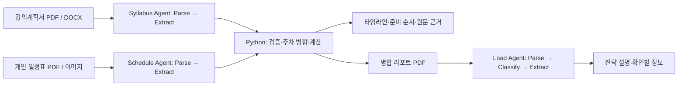

# SyllaSync · 실라싱크

강의계획서의 시험·과제를 한 학기 타임라인으로 모으고, 평가 비중과 남은 주차로 준비 순서를 제안하는 대학생용 도구입니다. 2026 Upstage × 고려대학교 세종캠퍼스 해커톤 프로젝트입니다.

팀명: **`std::~bug()`**

**[공개 데모 열기](https://syllasync-hackathon-2026-es3u98ijuj2rytawpirmvv.streamlit.app/)** — API 키 없이 가상 샘플 대시보드를 체험할 수 있습니다.

| 이름 | 역할 및 주요 담당 |
|---|---|
| 최영 | 팀장 · 프로젝트 총괄 — 서비스 기획 및 구현 총괄, 웹 UI 개선, Upstage API 연동·검증, 외부 배포, 데모·발표자료 및 최종 제출 총괄 |
| 신효재 | 서비스 기획 · UX 검토 — 사용자 이용 시나리오와 화면 흐름 검토, 서비스 사용성 개선 지원 |
| 박준영 | 서비스 기획 — 2라운드 프로젝트 기획서 작성, 문제 정의와 서비스 요구사항 정리 |
| 박재현 | Studio Agent 구성 — 2라운드 Studio JSON 파일 제작, 문서 추출 워크플로우 구성 |
| 김진영 | 품질 검증 · 발표 준비 — 테스트 시나리오와 결과 확인 항목 정리, 시연·발표 준비 지원 |


## 실행

Python 3.11 이상에서 프로젝트 폴더를 열어 실행합니다.

```bash
python -m venv .venv
# Windows: .venv\Scripts\activate
# macOS / Linux: source .venv/bin/activate
pip install -r requirements.txt
streamlit run app.py
```

브라우저에서 `http://localhost:8501`에 접속하면 가상 샘플 대시보드가 바로 열립니다. API 키 없이 타임라인, 우선순위, 원문 근거, 일정 수정, PDF·JSON 다운로드를 확인할 수 있습니다. **가상 샘플로 학기 분석** 버튼으로 수정한 샘플을 초기화할 수 있습니다.

## 외부 배포

현재 상태: Streamlit Community Cloud 공개 배포 완료. 로그인 없이 최신 대시보드 접속, 탭 이동, 일정 수정, PDF·JSON 다운로드, 모바일 화면을 확인했습니다.

공개 주소: https://syllasync-hackathon-2026-es3u98ijuj2rytawpirmvv.streamlit.app/

GitHub 저장소의 코드를 Streamlit Community Cloud에 연결해 무료로 배포합니다. GitHub Pages는 정적 사이트 호스팅이므로 Python 서버가 필요한 이 앱을 그대로 실행할 수 없습니다. [GitHub Pages 안내](https://docs.github.com/en/pages/getting-started-with-github-pages/what-is-github-pages)

1. [Streamlit Community Cloud](https://share.streamlit.io/)에 GitHub 계정으로 로그인합니다.
2. **Create app → Deploy a public app from GitHub**에서 아래 값을 지정합니다.
   - Repository: `o3oC4T/syllasync-hackathon-2026`
   - Branch: `main`
   - Main file path: `app.py`
   - Advanced settings → Python: `3.12`
3. **Deploy**를 누릅니다. API 키 없이 가상 샘플 대시보드가 실행됩니다.
4. 실제 발급된 `https://…streamlit.app` 공개 주소를 확인하고 제출 양식 3-3에 입력합니다.

기존 포트폴리오와 별도 저장소·주소를 사용합니다. [Streamlit 공식 배포 안내](https://docs.streamlit.io/deploy/streamlit-community-cloud/deploy-your-app/deploy)

실제 Studio 분석을 활성화할 때는 Streamlit Cloud의 Secrets에 `.streamlit/secrets.toml.example` 형식으로 API 키와 Agent ID를 설정합니다. 서버 API 키는 브라우저 입력란의 기본값에 넣지 않으며, 개인 키를 입력하면 해당 세션에서 우선 사용합니다. 서버 키를 등록하면 방문자가 그 키로 Studio 분석을 실행할 수 있습니다.

## 화면 디자인

[Tabler](https://docs.tabler.io/ui/getting-started)의 MIT 라이선스 UI 키트 **1.4.0**과 **Tabler Icons 3.35.0**을 실제 정적 자산으로 포함했습니다. Tabler 카드·배지·표·아바타를 사용하고, SyllaSync의 녹색 브랜드와 학기 계획 흐름에 맞춰 구성했습니다. 외부 CDN에 연결하지 않아도 디자인이 표시됩니다.

- 과목별 일정표와 주차별 집중도 막대, 다가오는 일정 카드
- 상위 3개 준비 항목과 주간 시간 배분 카드
- 원문 인용문·출처, 직접 수정, 단계별 처리 흐름
- 모바일에서는 지표를 2열로 표시하고 넓은 일정표 안에서 가로 스크롤
- 화면에 표시할 문서 내용을 HTML 이스케이프하고, 입력·탭·다운로드는 Streamlit 기본 컨트롤 사용

Tabler CSS는 `.ss` 영역으로 범위를 제한해 Streamlit 기본 입력창과 분리했습니다. 추가 스타일은 `assets/dashboard.css`, 화면 구성요소는 `ui.py`에 있습니다. 두 프로젝트의 MIT 저작권·허가문은 `assets/vendor/`에 보존했으며, Streamlit은 화면 검증에 사용한 `1.66.0`으로 고정했습니다.

학교 계정의 Studio Agent 3개를 생성하고 강의계획서·일정표·병합 리포트로 실제 API 실행을 확인했습니다. 공개 사이트의 가상 샘플 모드와 실제 API 모드는 구분해 표시합니다.

## 현재 구현 범위

| 기능 | 상태 |
|---|---|
| 다과목 주차 병합, 집중 주간, 준비 우선순위 | 가상 샘플 및 실제 Studio 추출 결과로 검증 |
| 근거 문장·출처 확인, 미정 값 표시, 일정 수정 | 구현 및 화면 검증 |
| PDF 리포트·JSON 내보내기 | 구현 및 다운로드 검증 |
| Upstage Studio Files / Responses 연동 | 실제 파일 업로드·작업 생성·조회·완료·파일 삭제 확인 |
| Syllabus / Schedule / Load Agent | 실제 구성·실행 완료, *.studio.json 최종 내보내기 제공 |
| 실제 Studio 실행·추출 확인 | 가상 문서 4개: 과목명 3/3, 일정 주차·비중 각 9/9, 가용시간 12시간 일치 |
| 외부 사이트 배포 | Streamlit Community Cloud 공개 배포, 비로그인 접속·수정·다운로드·모바일 확인 |

`data/demo.json`은 직접 작성한 가상 PDF에 맞춘 수작업 정답 데이터입니다. API 추출 결과나 모델 정확도 측정 자료가 아닙니다. `agent_configs/*.studio.json`은 실제 Studio에서 내보낸 최종 설정입니다. `*.draft.json`은 초기 설계 참고용입니다. 실제 추출 응답은 `tests/fixtures/studio/`에 보관했으며, 테스트 결과는 소규모 가상 문서에 한정됩니다.

## 처리 흐름



Studio API 모드에서는 파일을 `/v2/files`로 업로드하고 `/v2/responses`로 Agent를 실행한 다음 완료 상태를 조회합니다. Syllabus와 Schedule은 JSON을 추출하고, 앱의 Python 코드가 검증·주차 병합·점수 계산을 맡습니다. Load Agent는 병합 리포트를 읽고 Red/Yellow/Green 분기에 맞춰 설명을 생성합니다. 실제 API가 실패하면 오류를 표시하며 가상 결과로 교체하지 않습니다.

## 실제 Studio 연결

1. 학교 계정용 Agent ID와 실행한 Config 버전은 `studio_agents.json`에 기본 설정했습니다. 이 값에는 API 키가 없습니다.
2. **Studio 연결 설정**에 해당 계정의 API 키를 입력하고 Enter로 적용하거나 `.env` / Streamlit Secrets의 `UPSTAGE_API_KEY`에 설정합니다.
3. **Studio API 분석**에서 강의계획서와 개인 일정표를 업로드합니다. **처리 흐름**에서 Load Agent 전략 설명을 생성할 수 있습니다.
4. 다른 계정으로 재현할 때는 `agent_configs/*.studio.json`을 Studio에서 가져와 샘플로 실행한 뒤, Agent ID와 Config ID 환경변수를 자신의 값으로 변경합니다.

Studio의 빈 날짜 문자열과 0 주차·페이지는 미정으로 변환합니다. 평가 비중 0%와 가용시간 0시간은 유효한 값으로 보존하며 범위를 벗어난 값은 검증 오류로 표시합니다.

API 키는 서버 환경 또는 비밀번호 입력란에서 읽습니다. `.env`와 업로드 원문은 저장소에 포함하지 않습니다. 처리 후 업로드 파일 삭제를 요청하며, 삭제에 실패하면 화면에 알립니다. 서비스 제공자의 작업 기록 보존 정책까지 삭제를 보장하지는 않습니다.

## 계산 기준

- Red: 같은 주 일정 3건 이상 또는 평가 비중 합계 80점 이상
- Yellow: 같은 주 일정 2건 이상 또는 평가 비중 합계 40점 이상
- Green: 그 외. 일정이 없는 주는 회색으로 표시
- 추천 점수: `평가 비중 / (남은 주차 + 1) * (1 + 0.25 * 같은 주 다른 일정 수)`
- 일정이나 개별 비중이 미정인 항목은 별도로 표시하고 추천 점수에서 제외
- 주간 가용시간이 있으면 점수 비율로 시간 배분을 제안. 실제 필요 시간 예측이 아님

서로 다른 과목의 비중을 더한 값은 상대적인 집중도 지표이며 전체 성적 비율이 아닙니다. 기준값은 팀이 정한 휴리스틱이고 사용자 효과를 측정한 결과는 없습니다. 같은 주 집중과 정확한 시각의 충돌을 구분합니다. 날짜만 주어진 경우 사용자가 설정한 1주차 시작일로 주차를 계산하고, 문서에 주차만 있으면 날짜를 임의 생성하지 않습니다.

## 검증

```bash
pip install -r requirements-dev.txt
python -m pytest -q tests
```

자동 테스트 19개: 집중 주간, 미정·지난 일정 제외, 비중 범위, 날짜 환산, 중복, API 응답·파일 정리·오류 표시, 서버 키 비노출, 실제 Studio 응답 호환성을 확인합니다. 실제 API로 가상 PDF 4개를 처리한 결과도 수작업 정답과 대조했습니다. 일반 문서의 추출 정확도와 학습 효과는 추가 평가가 필요합니다.

## 디렉터리

```text
app.py                 Streamlit 화면 및 상호작용
ui.py                  Tabler 기반 화면 구성요소
models.py              추출 데이터 계약 및 검증
analysis.py            병합·위험도·우선순위
studio.py              Upstage Files / Responses 클라이언트
pdf_export.py          PDF 리포트 생성
studio_contract.py     실제 추출 응답의 빈 값·텍스트 목록 변환
studio_agents.json      실행 검증한 Agent ID / Config 버전 (비밀키 없음)
agent_configs/         실제 Studio 최종 내보내기 3개 + 설계 초안
data/                  가상 PDF 4개와 수작업 정답 JSON
tests/                 계산·응답·오류 처리 테스트
assets/dashboard.css   SyllaSync 화면 스타일
assets/vendor/         Tabler CSS·아이콘 및 MIT 라이선스
assets/                화면 이미지, 한글 폰트와 OFL 라이선스
```

## 참고 자료

- [해커톤 공식 스타터 코드](https://github.com/SuWanKim-code/document-agent-hackathon-starter-code): Agent 연동 흐름 및 설정 JSON 형식 참고. 애플리케이션 코드는 본 프로젝트에서 새로 작성했습니다.
- [Upstage Create job](https://console.upstage.ai/api/agents/jobs/create-job)
- [Upstage Retrieve job](https://console.upstage.ai/api/agents/jobs/retrieve-job)
- [Upstage Document Parse](https://console.upstage.ai/api/parse/document-parsing)
- [Tabler](https://github.com/tabler/tabler), [Tabler Icons](https://github.com/tabler/tabler-icons): UI 구성요소와 아이콘, MIT 라이선스.
- Nanum Gothic: `assets/OFL.txt` 라이선스에 따라 사용합니다.
