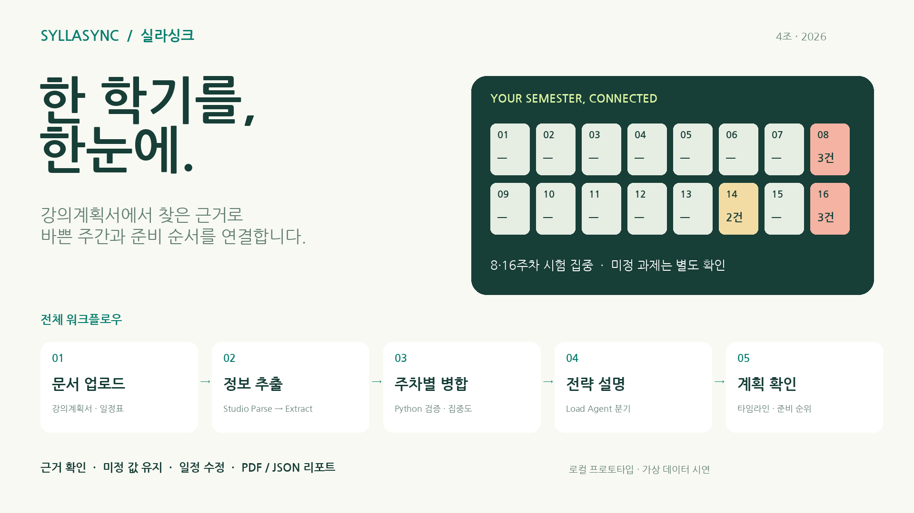
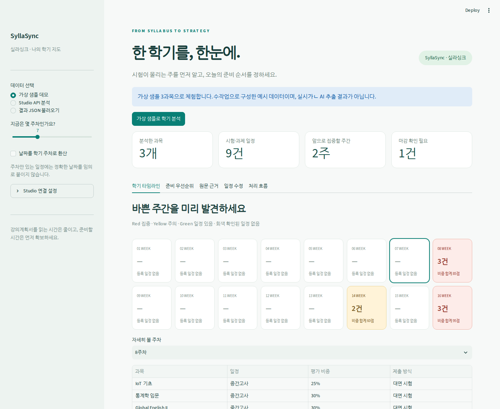
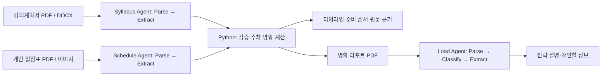

# SyllaSync · 실라싱크

강의계획서의 시험·과제를 한 학기 타임라인으로 모으고, 평가 비중과 남은 주차로 준비 순서를 제안하는 대학생용 도구입니다. 2026 Upstage × 고려대학교 세종캠퍼스 해커톤 프로젝트입니다.





## 실행

Python 3.11 이상에서 프로젝트 폴더를 열어 실행합니다.

```bash
python -m venv .venv
# Windows: .venv\Scripts\activate
# macOS / Linux: source .venv/bin/activate
pip install -r requirements.txt
streamlit run app.py
```

브라우저에서 `http://localhost:8501`에 접속한 뒤 **가상 샘플로 학기 분석**을 누릅니다. API 키 없이 타임라인, 우선순위, 원문 근거, 일정 수정, PDF·JSON 다운로드를 확인할 수 있습니다.

## 현재 구현 범위

| 기능 | 상태 |
|---|---|
| 다과목 주차 병합, 집중 주간, 준비 우선순위 | 가상 샘플로 로컬 검증 |
| 근거 문장·출처 확인, 미정 값 표시, 일정 수정 | 구현 및 화면 검증 |
| PDF 리포트·JSON 내보내기 | 구현 및 다운로드 검증 |
| Upstage Studio Files / Responses 연동 | 코드 구현, 요청 구조와 오류 처리를 모의 응답으로 검증 |
| Syllabus / Schedule / Load Agent | Studio 가져오기용 설정 초안 제공 |
| 실제 Studio 실행·추출 정확도 | API 키와 팀 Agent ID가 없어 미검증 |
| 외부 사이트 배포 | 미배포 |

`data/demo.json`은 직접 작성한 가상 PDF에 맞춘 수작업 정답 데이터입니다. API 추출 결과나 모델 정확도 측정 자료가 아닙니다. `agent_configs/*.draft.json`은 공개 스타터 코드의 설정 구조를 참고해 새로 구성한 초안이며, 팀 Studio에서 내보낸 최종 파일이 아닙니다.

## 처리 흐름



Studio API 모드에서는 파일을 `/v2/files`로 업로드하고 `/v2/responses`로 Agent를 실행한 다음 완료 상태를 조회합니다. Syllabus와 Schedule은 JSON을 추출하고, 앱의 Python 코드가 검증·주차 병합·점수 계산을 맡습니다. Load Agent는 병합 리포트를 읽고 Red/Yellow/Green 분기에 맞춰 설명을 생성합니다. 실제 API가 실패하면 오류를 표시하며 가상 결과로 교체하지 않습니다.

## 실제 Studio 연결

1. `agent_configs`의 초안을 Studio에서 가져오거나 같은 노드·스키마로 에이전트를 구성합니다. Studio 버전에 따라 가져오기 형식 조정이 필요할 수 있습니다.
2. `data/sample_01_iot.pdf`, `sample_02_statistics.pdf`, `sample_03_english.pdf`를 Syllabus Agent로 각각 실행해 출력 구조와 근거를 확인합니다. Schedule Agent는 `sample_04_schedule.pdf`로 확인합니다.
3. `.env.example`을 `.env`로 복사해 API 키와 Agent ID를 입력합니다. Config ID는 Studio의 Use via API에서 확인한 값을 사용하거나 비워서 최신 설정을 사용합니다.
4. 앱의 **Studio API 분석**에서 PDF를 올려 분석합니다. **처리 흐름** 탭에서 Load Agent를 실행할 수 있습니다.
5. Studio에서 최종 설정을 내보내어 제출합니다. 이 저장소의 초안을 실제 내보내기 파일로 오인하지 않도록 합니다.

API 키는 서버 환경 또는 비밀번호 입력란에서 읽습니다. `.env`와 업로드 원문은 저장소에 포함하지 않습니다. 처리 후 업로드 파일 삭제를 요청하며, 삭제에 실패하면 화면에 알립니다. 서비스 제공자의 작업 기록 보존 정책까지 삭제를 보장하지는 않습니다.

## 계산 기준

- Red: 같은 주 일정 3건 이상 또는 평가 비중 합계 80점 이상
- Yellow: 같은 주 일정 2건 이상 또는 평가 비중 합계 40점 이상
- Green: 그 외. 일정이 없는 주는 회색으로 표시
- 추천 점수: `평가 비중 / (남은 주차 + 1) * (1 + 0.25 * 같은 주 다른 일정 수)`
- 일정이나 개별 비중이 미정인 항목은 별도로 표시하고 추천 점수에서 제외
- 주간 가용시간이 있으면 점수 비율로 시간 배분을 제안. 실제 필요 시간 예측이 아님

서로 다른 과목의 비중을 더한 값은 상대적인 집중도 지표이며 전체 성적 비율이 아닙니다. 기준값은 팀이 정한 휴리스틱이고 사용자 효과를 측정한 결과는 없습니다. 같은 주 집중과 정확한 시각의 충돌을 구분합니다. 날짜만 주어진 경우 사용자가 설정한 1주차 시작일로 주차를 계산하고, 문서에 주차만 있으면 날짜를 임의 생성하지 않습니다.

## 검증

```bash
pip install -r requirements-dev.txt
python -m pytest -q tests
```

검증 항목: 8·16주차 집중, 14주차 주의, 미정 일정 제외, 지난 일정 제외, 평가 비중 범위, 날짜 환산, 중복 제외, API 결과 파싱, 파일 정리 및 실패 노출. 가상 샘플의 예측 가능한 결과를 확인하는 테스트이며 실제 AI 정확도 측정은 별도 수행해야 합니다.

## 디렉터리

```text
app.py                 Streamlit 화면
models.py              추출 데이터 계약 및 검증
analysis.py            병합·위험도·우선순위
studio.py              Upstage Files / Responses 클라이언트
pdf_export.py          PDF 리포트 생성
agent_configs/         Studio 설정 초안 3개
data/                  가상 PDF 4개와 수작업 정답 JSON
tests/                 계산·응답·오류 처리 테스트
assets/                한글 폰트와 OFL 라이선스
```

## 참고 자료

- [해커톤 공식 스타터 코드](https://github.com/SuWanKim-code/document-agent-hackathon-starter-code): Agent 연동 흐름 및 설정 JSON 형식 참고. 애플리케이션 코드는 본 프로젝트에서 새로 작성했습니다.
- [Upstage Create job](https://console.upstage.ai/api/agents/jobs/create-job)
- [Upstage Retrieve job](https://console.upstage.ai/api/agents/jobs/retrieve-job)
- [Upstage Document Parse](https://console.upstage.ai/api/parse/document-parsing)
- Nanum Gothic: `assets/OFL.txt` 라이선스에 따라 사용합니다.
